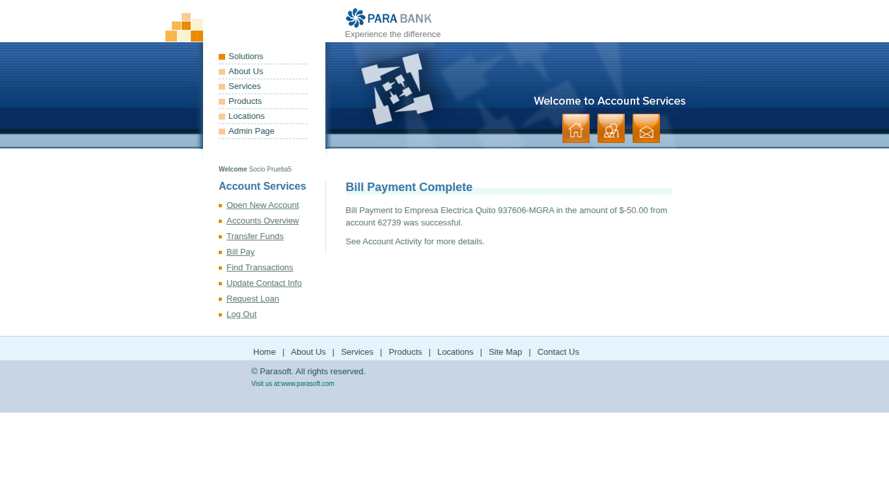

# Defectos y observaciones

Defectos del flujo de pago de servicios (Bill Pay) confirmados en la demo pública de ParaBank. Cada uno tiene una
prueba `@known-defect` que valida el comportamiento esperado y falla mientras el defecto exista.

| ID | Título | Severidad | Casos | Estado |
| --- | --- | --- | --- | --- |
| DEF-001 | Se aceptan pagos con monto cero o negativo; el negativo aumenta el saldo | Crítica | CP-010, CP-011 | Abierto |
| DEF-002 | Se aceptan pagos mayores al saldo disponible | Alta | CP-012 | Abierto |
| DEF-003 | La API REST entrega datos de cuentas sin autenticación | Crítica | CP-021 | Abierto |

Entorno: demo pública <https://parabank.parasoft.com/parabank/>, Playwright 1.65 (Chromium), Newman 6, Node 22 en
ubuntu-latest. Cada prueba registra su propio socio y abre una cuenta CHECKING nueva.

## DEF-001: Se aceptan pagos con monto cero o negativo

- **Severidad:** crítica, un socio puede acreditarse dinero en su propia cuenta.
- **Criterio incumplido:** AC-03 (el monto debe ser mayor que cero).
- **Pruebas:** `web/tests/bill-pay-regression.spec.ts`, `api/tests/billpay.api.spec.ts` y Postman `04-defectos-conocidos`.

**Pasos (web)**

1. Iniciar sesión con un socio que tenga una cuenta con saldo.
2. Ir a Bill Pay y llenar los datos del beneficiario con valores válidos.
3. Ingresar `Amount` = `-50.00` (o `0`).
4. Presionar Send Payment y revisar el saldo en Accounts Overview.

**Pasos (API)**

```http
POST /parabank/services/bank/billpay?accountId={id}&amount=-50.00
```

**Esperado:** el pago se rechaza con un mensaje claro (web) o un HTTP 4xx (API), y el saldo no cambia.

**Obtenido:**

| Canal | Monto | Respuesta | Saldo |
| --- | --- | --- | --- |
| Web | 0 y -50.00 | "Bill Payment Complete ... was successful." | - |
| API (Playwright) | 0 y -50.00 | HTTP 200 con el pago registrado | - |
| Postman | 0 | HTTP 200 | Sin cambio (100.00) |
| Postman | -50.00 | HTTP 200 | Sube de 100.00 a 150.00 |

El servicio resta el monto sin validar el signo, así que un monto negativo termina siendo un crédito.

**Evidencia:** [monto 0](capturas/DEF-001-web-cp010-monto-cero-aceptado.png),
[monto -50.00](capturas/DEF-001-web-cp011-monto-negativo-aceptado.png),
[`defectos-playwright.xml`](reportes/junit/defectos-playwright.xml) y
[`defectos-newman.xml`](reportes/junit/defectos-newman.xml).



**Recomendación:** validar `amount > 0` en el servidor y responder 400 con un mensaje de negocio. La validación del
formulario ayuda, pero no puede ser el único control.

## DEF-002: Se aceptan pagos mayores al saldo disponible

- **Severidad:** alta, la cuenta queda en negativo sin ningún control.
- **Criterio incumplido:** AC-05.
- **Pruebas:** `api/tests/billpay.api.spec.ts` y Postman `04-defectos-conocidos`.

**Pasos**

1. Abrir una cuenta CHECKING nueva (saldo inicial de 100.00 en la demo).
2. Enviar `POST /services/bank/billpay?accountId={id}&amount=1100.00` con un beneficiario válido.
3. Consultar `GET /services/bank/accounts/{id}`.

**Esperado:** HTTP 4xx por fondos insuficientes y saldo sin cambios.

**Obtenido:** HTTP 200. En Postman el saldo bajó de 150.00 a -999849.00 (el saldo previo era 150.00 porque DEF-001 ya
había sumado 50.00).

**Evidencia:** los JUnit de defectos (mensaje `saldo antes 150, después -999849`).

**Recomendación:** validar los fondos antes de debitar, dentro de la misma transacción.

## DEF-003: La API REST entrega datos de cuentas sin autenticación

- **Severidad:** crítica, expone datos financieros (autenticación rota y acceso a objetos ajenos).
- **Criterio incumplido:** AC-01.
- **Pruebas:** `api/tests/accounts.api.spec.ts` y Postman `04-defectos-conocidos`.

**Pasos**

```bash
curl -i -H "Accept: application/json" \
  https://parabank.parasoft.com/parabank/services/bank/customers/{customerId}/accounts
```

**Esperado:** 401 o 403.

**Obtenido:** HTTP 200 con las cuentas del cliente, sin cookie ni cabecera de autorización. Basta con conocer o
adivinar el `customerId`, que es numérico. El mismo cliente API de la suite no envía credenciales y aun así registra
pagos, consulta saldos y abre cuentas.

**Evidencia:** los JUnit de defectos (`expected 200 to be one of [ 401, 403 ]`).

**Recomendación:** exigir autenticación en todos los recursos de `/services/bank` y validar que el `customerId`
pertenezca al usuario autenticado.

ParaBank es una aplicación de práctica y es probable que esto sea intencional. Se reporta porque en un banco real
bloquearía la salida a producción.

## Observaciones

| ID | Observación | Caso |
| --- | --- | --- |
| OBS-01 | La confirmación del pago no muestra un número de transacción o referencia | CP-002 |
| OBS-02 | Un monto como `10abc` muestra "An internal error has occurred and has been logged." en vez de un mensaje de validación ([captura](capturas/CP-020-monto-no-interpretable.png)) | CP-020 |
| OBS-03 | El campo teléfono genera `id` y `class` aleatorios en cada carga, lo que dificulta la automatización | CP-014 |
| OBS-04 | La API no documenta un contrato de errores (códigos y cuerpo) | CP-013, CP-020 |
| OBS-05 | No hay protección visible contra el doble envío del pago | CP-018 (manual) |
