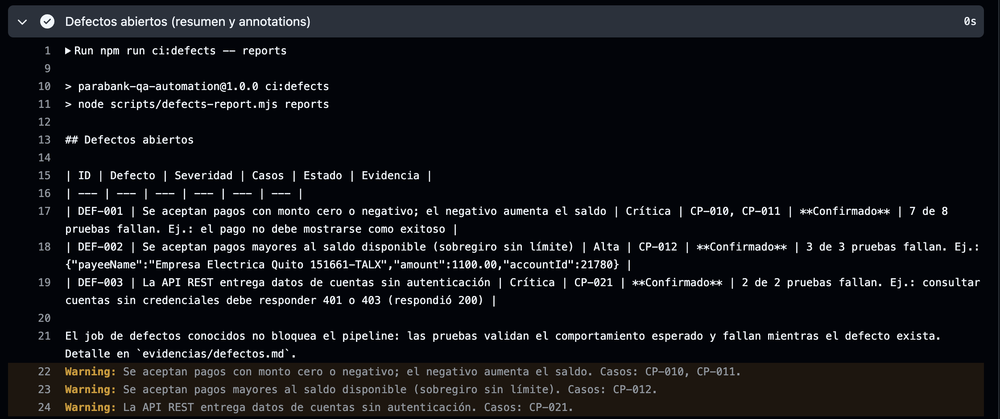
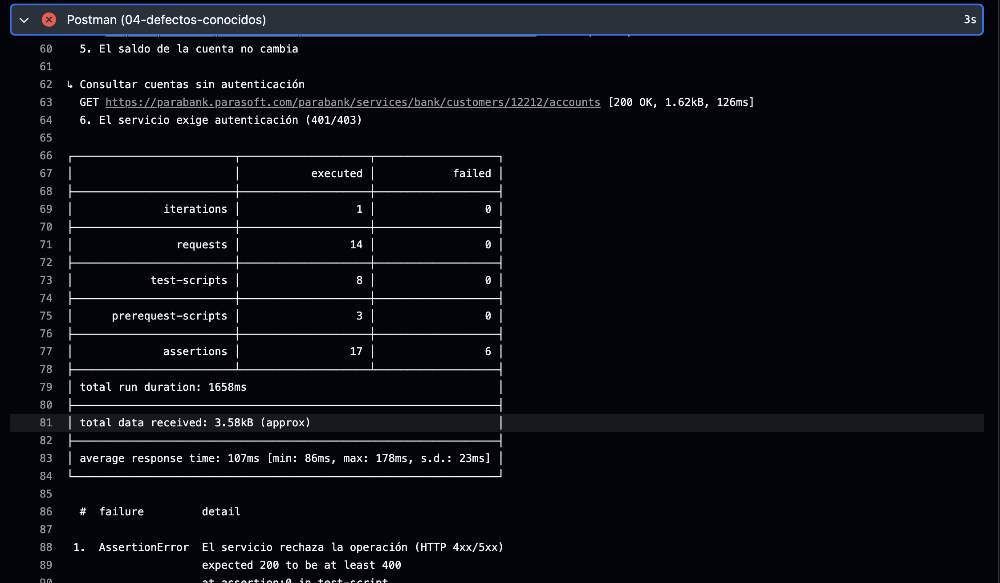

# Reporte de ejecución

Resultados de la ejecución del workflow [`qa-pipeline.yml`](../.github/workflows/qa-pipeline.yml) en GitHub Actions
contra la demo pública de ParaBank. Los números salen de los logs y de los JUnit guardados en
[`reportes/junit/`](reportes/junit). No hay datos simulados; el análisis de rendimiento con datos del enunciado está
en [`performance/`](../performance/analisis-datos-simulados.md).

## Resultado por job

| Job | Qué ejecuta | Resultado | Duración |
| --- | --- | --- | --- |
| Calidad de código | ESLint, `tsc --noEmit`, Prettier y validación del `.jmx` | OK | 27 s |
| Pruebas web | Playwright en `web-chromium` (1366x768) y `web-mobile` (Pixel 7) | OK, 28/28 | 1 min 11 s |
| Pruebas API (Playwright) | Playwright `request` contra `/services/bank` | OK, 8/8 | 18 s |
| Pruebas API (Postman) | Carpetas 01, 02 y 03 de la colección | OK, 25/25 aserciones | 20 s |
| Defectos conocidos | Pruebas `@known-defect` y carpeta 04 de Postman | Falla por diseño: 12 fallos que confirman 3 defectos | 1 min 10 s |
| Resumen | Junta los JUnit en el resumen del run | OK | 13 s |

El workflow queda en verde porque el job de defectos no bloquea (`continue-on-error`).

## Totales

| Reporte | Total | Pasaron | Fallaron | Tiempo (s) |
| --- | ---: | ---: | ---: | ---: |
| Web (Playwright) | 28 | 28 | 0 | 44.0 |
| API (Playwright) | 8 | 8 | 0 | 4.1 |
| API (Postman, aserciones) | 25 | 25 | 0 | 1.5 |
| Defectos (Playwright) | 6 | 0 | 6 | 25.4 |
| Defectos (Postman, aserciones) | 17 | 11 | 6 | 0.7 |

Suite principal: 61 de 61 verificaciones en verde. En la suite de defectos, las 11 aserciones de Postman que pasan son
la preparación de datos (login, cuenta nueva, saldo inicial) y el saldo sin cambios en el pago de monto 0.

## Detalle por caso

### Web (Chromium y mobile)

| Caso | Escenario | Chromium | Mobile |
| --- | --- | :-: | :-: |
| CP-001 | Inicio de sesión válido | Pasó | Pasó |
| CP-001b | Inicio de sesión con el usuario de demostración | Pasó | - |
| CP-002 | Pago básico con datos válidos | Pasó | Pasó |
| CP-003 | El pago descuenta el saldo y aparece como débito | Pasó | - |
| CP-004 | Monto mínimo (0.01) | Pasó | - |
| CP-005 | Contraseña incorrecta y usuario inexistente | Pasó (2) | - |
| CP-005c | Credenciales vacías | Pasó | - |
| CP-006 | Bill Pay sin sesión | Pasó | - |
| CP-007 | Formulario vacío | Pasó | - |
| CP-008 | Cuenta de verificación distinta | Pasó | - |
| CP-009 | Formatos no numéricos | Pasó (3) | - |
| CP-014 | Cada campo obligatorio vacío | Pasó (9) | - |
| CP-015 | Accounts Overview coincide con el detalle | Pasó | - |
| CP-016 | Cerrar sesión invalida el acceso | Pasó | - |
| CP-020 | Monto no interpretable | Pasó | - |

### API (Playwright)

Pasaron CP-001, CP-002/003, CP-004, CP-005, CP-013, CP-015, CP-017 y CP-020.

### Postman / Newman

14 peticiones, 12 scripts de prueba y 25 aserciones sin fallos. Tiempo medio de respuesta de 120 ms (mínimo 90 ms,
máximo 370 ms).

### Defectos conocidos

| Caso | Herramienta | Resultado obtenido | Defecto |
| --- | --- | --- | --- |
| CP-010 | Web | "Bill Payment Complete" con monto $0.00 | DEF-001 |
| CP-011 | Web | "Bill Payment Complete" con monto $-50.00 | DEF-001 |
| CP-010 | API | HTTP 200 con monto 0 | DEF-001 |
| CP-011 | API | HTTP 200 con monto -50.00 | DEF-001 |
| CP-012 | API | HTTP 200 al pagar 1100.00 con saldo 100.00 | DEF-002 |
| CP-021 | API | HTTP 200 sin credenciales | DEF-003 |
| CP-010 | Postman | HTTP 200, el saldo no cambia | DEF-001 |
| CP-011 | Postman | HTTP 200, el saldo sube de 100.00 a 150.00 | DEF-001 |
| CP-012 | Postman | HTTP 200, el saldo baja de 150.00 a -999849.00 | DEF-002 |
| CP-021 | Postman | HTTP 200 en lugar de 401/403 | DEF-003 |

## Primera ejecución con fallas

En la primera corrida fallaron 15 de 28 pruebas web (CP-007, CP-008, CP-009, CP-014 y CP-020). La causa estaba en
`BillPayPage.expectPaymentNotCompleted`: el localizador combinaba `#billpayResult`, `#billpayError` y los mensajes de
validación con `or()`. ParaBank deja esos bloques siempre en el DOM y solo cambia su visibilidad, así que el localizador
encontraba varios elementos y Playwright lo rechazaba en modo estricto. Los mensajes de validación sí aparecían, es
decir, la aplicación se comportaba bien. Se corrigió filtrando solo los elementos visibles (`filter({ visible: true })`).

También había un problema en la colección Postman: una aserción dentro del callback de `pm.sendRequest` se perdía en
Newman cuando fallaba, y el saldo nunca se reportaba. Se arregló moviendo el `pm.test` dentro del callback.

## Artefactos y capturas

El workflow publica estos artefactos en cada run:

| Artefacto | Contenido |
| --- | --- |
| `reportes-web` | HTML de Playwright, JUnit, JSON, capturas, videos y trazas |
| `reportes-api` | HTML, JUnit y JSON de las pruebas API |
| `reportes-postman` | Reporte htmlextra y JUnit de Newman |
| `reportes-defectos` | Reportes de las pruebas `@known-defect` |

En el repositorio hay una copia ligera: los JUnit en [`reportes/junit/`](reportes/junit) y las capturas en
[`capturas/`](capturas):

| Captura | Caso |
| --- | --- |
| `CP-002-pago-exitoso-desktop.png` y `CP-002-pago-exitoso-mobile.png` | Confirmación del pago en escritorio y en Pixel 7 |
| `CP-003-debito-en-actividad.png` | Débito del pago en la actividad de la cuenta |
| `CP-007-formulario-vacio.png` | Mensajes de campo obligatorio |
| `CP-008-cuenta-verificacion-distinta.png` | Mensaje "The account numbers do not match." |
| `CP-015-overview-vs-detalle.png` | Detalle de la cuenta tras el pago |
| `CP-020-monto-no-interpretable.png` | Error genérico ante el monto `10abc` |
| `DEF-001-web-cp010-monto-cero-aceptado.png` | Pago de $0.00 aceptado |
| `DEF-001-web-cp011-monto-negativo-aceptado.png` | Pago de $-50.00 aceptado |
